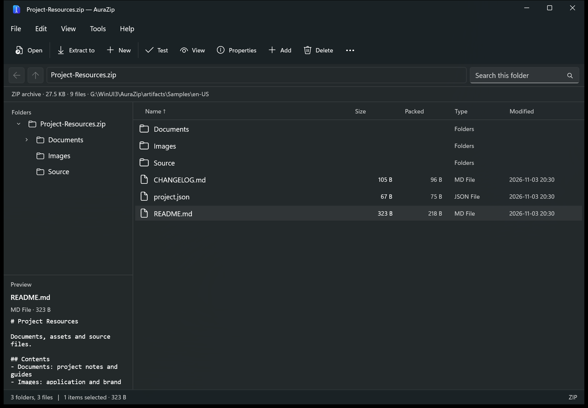
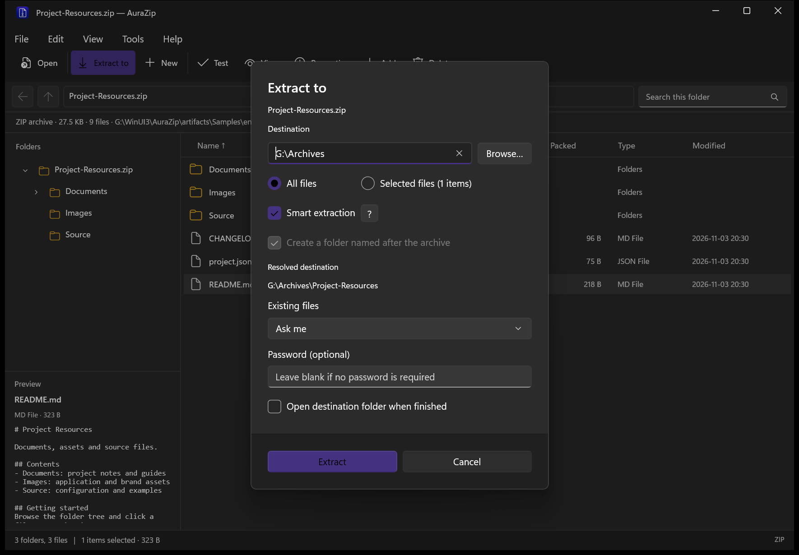
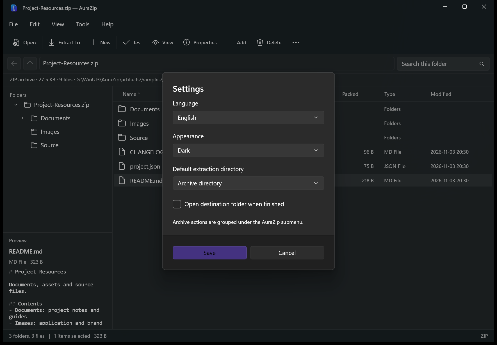

<p align="center"></p>

# AuraZip

**English** · [简体中文](README.zh-CN.md)

An open-source archive manager for Windows, built with WinUI 3. Browse archive contents directly, extract and compress files, create split archives, use encryption, and access common actions from File Explorer.

> **Microsoft Store**
>
> **[Get AuraZip from the Microsoft Store →](https://apps.microsoft.com/store/detail/9NZPMKKZS562?cid=DevShareMCLPCS)**
>
> Install AuraZip and receive app updates through the Microsoft Store.

[Feature list](FEATURES.md) · [Development](docs/DEVELOPMENT.md) · [Roadmap](ROADMAP.md) · [Third-party components](docs/THIRD_PARTY.md)

## Features

- Browse and extract ZIP, 7Z, RAR, TAR, and common compressed TAR formats, with support for multipart archives and passwords.
- Create ZIP, 7Z, TAR, TAR.GZ, TAR.BZ2, and TAR.XZ archives, with custom volume sizes in MB or GB. Compress individual files directly to GZ, BZ2, or XZ.
- Smart extraction: extract a single top-level item directly, or create a folder named after the archive when it contains multiple top-level items.
- Add, update, delete, and rename entries in single-volume ZIP and 7Z archives. Save nested edits through every containing ZIP or 7Z archive, and confirm externally edited files before saving them back.
- Create and edit RAR archives using a separately installed WinRAR command-line encoder. RAR extraction works without WinRAR; RAR archives also support nested writeback when the encoder is available.
- Navigate with a folder tree and preview text, images, PDF pages, Office documents, audio, and video. Office previews offer text and basic layout modes, document passwords, and legacy DOC/XLS/PPT support, with parsing isolated in a resource-limited process.
- Keep previews visible below the file list in narrow windows, with a toolbar action to show or hide the pane.
- Access modern Windows 11 and classic context-menu actions under a single AuraZip submenu.
- Search across an archive with wildcards, copy or drag files out, test archive integrity, compare SHA-256 and MD5 hashes, and edit ZIP comments.
- Switch instantly between English and Simplified Chinese. Follow the system theme or choose light or dark mode.

See [FEATURES.md](FEATURES.md) for supported formats, previews, and file operations.

## Screenshots

### Archive browsing and preview



### Smart extraction



### Language and appearance



## Install

Get AuraZip from the [Microsoft Store](https://apps.microsoft.com/store/detail/9NZPMKKZS562?cid=DevShareMCLPCS).

Supports Windows 10 version 1809 and later, with x86 and x64 packages. Modern File Explorer context menus are available on Windows 11.

## Build from source

Requires Windows, the .NET 8 SDK, and Visual Studio 2026 with Windows App SDK C# and C++ build tools. Import [`.vsconfig`](.vsconfig) using Visual Studio Installer to install the required components.

```powershell
# Build and run
.\scripts\Run.ps1

# Open an archive
.\scripts\Run.ps1 -ArchivePath 'C:\Archives\example.zip'

# Run core tests
dotnet run --project tests/AuraZip.Core.Tests
```

See the [development guide](docs/DEVELOPMENT.md) for build, test, and publishing instructions.

## Repository layout

| Path | Purpose |
| --- | --- |
| `AuraZip/` | WinUI 3 application, settings, localization, icons, and package manifest |
| `AuraZip.Core/` | Archive reading, extraction, compression, editing, hashing, and isolated Office text and layout parsing |
| `AuraZip.Shell/` | Modern and classic File Explorer context-menu extensions |
| `scripts/` | Build, launch, packaging, engine verification, icon, and sample-generation scripts |
| `tests/` | Core, native-menu, and UI tests, with archive fixtures |
| `docs/` | Development documentation, third-party notices, and screenshots |
| `ArchiveFormats.json` | Archive extension list shared by the application and shell extension |
| `AuraZip.slnx` | Visual Studio solution |

## License

Copyright (C) 2026 AuraZip contributors.

AuraZip is licensed under the **GNU General Public License v3.0 or later (GPL-3.0-or-later)**. You may use, modify, and redistribute the project under its terms. See [LICENSE](LICENSE) for the full license text.

AuraZip uses SharpCompress for archive browsing and general extraction, and the bundled official 7-Zip engine for compression, encrypted archive extraction, and authentication checks. Third-party license notices and the corresponding 7-Zip source are included in the repository. See [third-party components](docs/THIRD_PARTY.md) for details.

Third-party components retain their respective copyright notices and licenses.
