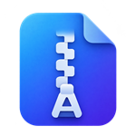
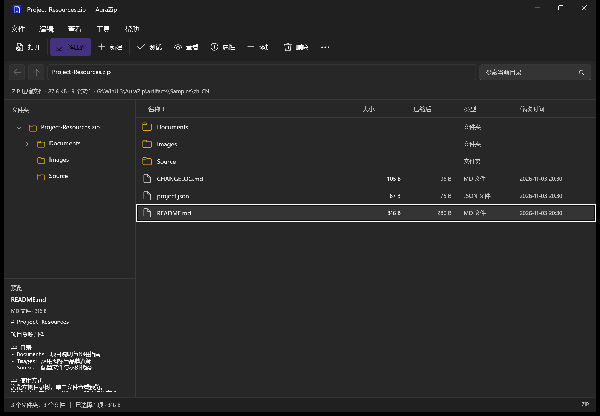
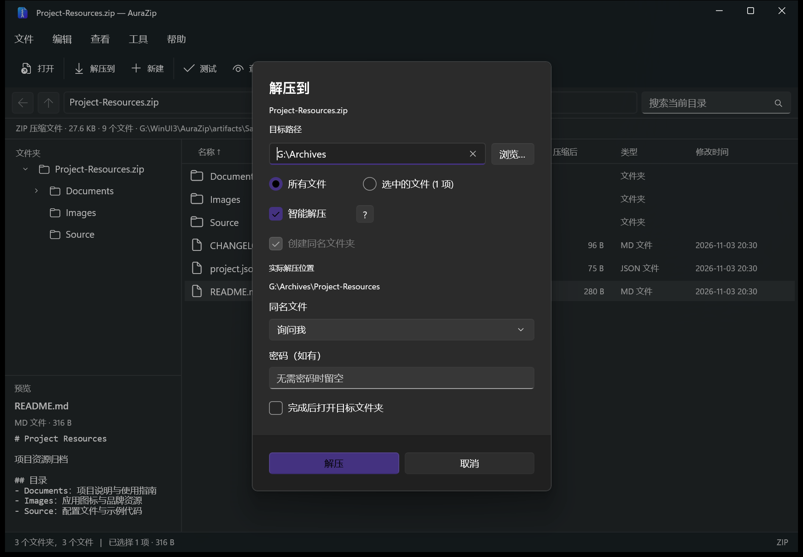
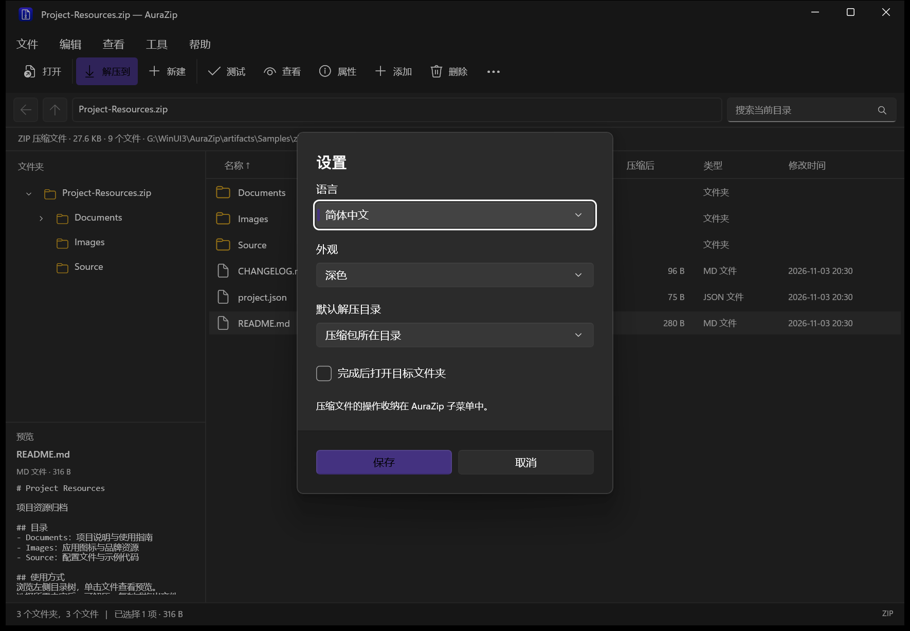

<p align="center"></p>

# AuraZip

[English](README.md) · **简体中文**

面向 Windows 的开源压缩文件管理工具，使用 WinUI 3 开发。直接浏览压缩包内容，支持解压、压缩、分卷、加密和资源管理器右键操作。

> **Microsoft Store**
>
> **[在 Microsoft Store 获取 AuraZip →](https://apps.microsoft.com/store/detail/9NZPMKKZS562?cid=DevShareMCLPCS)**
>
> 通过 Microsoft Store 安装 AuraZip 并获取应用更新。

[功能清单](FEATURES.md) · [开发与构建](docs/DEVELOPMENT.md) · [Roadmap](ROADMAP.md) · [第三方组件](docs/THIRD_PARTY.md)

## 主要功能

- 浏览和解压 ZIP、7Z、RAR、TAR 及常见 TAR 压缩格式，支持分卷包与密码输入。
- 创建 ZIP、7Z、TAR、TAR.GZ、TAR.BZ2、TAR.XZ，自定义分卷大小，支持 MB、GB 和小数；单个文件可直接创建 GZ、BZ2、XZ。
- 智能解压：顶层只有一个项目时直接输出，多个项目时自动创建同名文件夹。
- 修改单卷 ZIP、7Z，支持添加、更新、删除和重命名；嵌套修改可逐层写回 ZIP、7Z 外包，外部编辑后的文件可确认写回。
- 调用单独安装的 WinRAR 命令行编码器创建和修改 RAR，支持 RAR 嵌套写回；RAR 解压无需安装 WinRAR。
- 左侧目录树与单击预览，支持文本、图片、PDF 翻页、Office 文档和音视频播放；Office 提供文本与基本版式模式，支持文档密码及旧版 DOC/XLS/PPT，解析过程在限制资源的独立进程中运行。
- 窄窗口下预览窗格移至文件列表下方，可从工具栏显示或隐藏。
- Windows 11 新版右键与传统右键菜单，操作统一收纳于 AuraZip 子菜单。
- 全包搜索、通配符、复制和拖出文件、完整性测试、SHA-256／MD5 比对与 ZIP 注释。
- 简体中文与 English 即时切换，支持系统、浅色和深色主题。

格式支持、文件预览与操作说明见 [FEATURES.md](FEATURES.md)。

## 界面截图

### 归档浏览与预览



### 智能解压



### 语言与外观



## 安装

正式安装入口：[Microsoft Store](https://apps.microsoft.com/store/detail/9NZPMKKZS562?cid=DevShareMCLPCS)。

支持 Windows 10 1809 及更新版本，提供 x86、x64 架构。新版资源管理器右键菜单适用于 Windows 11。

## 从源码运行

需要 Windows、.NET 8 SDK，以及 Visual Studio 2026 的 Windows App SDK C# 和 C++ 构建工具。可在 Visual Studio Installer 中导入 [`.vsconfig`](.vsconfig)。

```powershell
# 构建并运行
.\scripts\Run.ps1

# 打开自己的压缩包
.\scripts\Run.ps1 -ArchivePath 'C:\Archives\example.zip'

# 核心测试
dotnet run --project tests/AuraZip.Core.Tests
```

构建、测试与发布步骤见 [开发文档](docs/DEVELOPMENT.md)。

## 仓库结构

| 路径 | 用途 |
| --- | --- |
| `AuraZip/` | WinUI 3 应用、设置、本地化、图标和打包清单 |
| `AuraZip.Core/` | 归档读取、解压、压缩、修改、哈希及独立进程内的 Office 文本和版式解析 |
| `AuraZip.Shell/` | Windows 11 与传统资源管理器右键扩展 |
| `scripts/` | 运行、打包、引擎校验、图标和测试样本生成脚本 |
| `tests/` | 核心测试、原生菜单测试、界面验证和测试样本 |
| `docs/` | 开发说明、第三方组件说明与界面截图 |
| `ArchiveFormats.json` | 应用与右键扩展共享的文件扩展名列表 |
| `AuraZip.slnx` | Visual Studio 解决方案入口 |

## 许可证

Copyright (C) 2026 AuraZip contributors.

AuraZip 采用 **GNU General Public License v3.0 or later（GPL-3.0-or-later）**。你可以按照许可证条款使用、修改和分发本项目。完整条款见 [LICENSE](LICENSE)。

归档浏览和常规解压使用 SharpCompress，压缩、加密归档解压及认证校验使用随附的官方 7-Zip 引擎。第三方许可证及对应的 7-Zip 源码随仓库保留，详见 [第三方组件说明](docs/THIRD_PARTY.md)。

第三方组件保留各自的版权声明和许可证。
